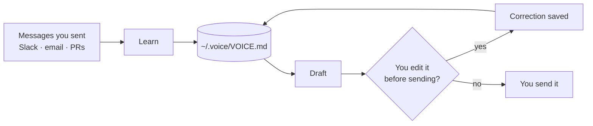

<div align="center">

# sound-like-me

**Your AI drafts messages that sound like you, not like an AI.**

A skill that learns how you actually write to people, from messages you've sent,<br>
and gets Claude, Codex, ChatGPT or any other agent to draft in that voice.<br>
One file, every tool.

[](#claude-code)
[](#codex)
[](#chatgpt--claudeai)
[](LICENSE)

</div>

---

## Same ask, two people

|                                  | Reply |
|----------------------------------|-------|
| **Teammate asks** "can you review my PR today?"<br>*default AI* | Hi! Absolutely, I'd be happy to review your PR today. I'll take a look this afternoon and share my feedback. Let me know if there's anything specific you'd like me to focus on! |
| *with sound-like-me*            | haan dekhta hu<br>shaam tak<br>kuch specific h toh bata |
| **Manager asks** the same thing<br>*with sound-like-me* | Will review it by EOD today. I'll flag if anything blocks the merge. |

<sub>The peer reply is Roman Hinglish: "yeah I'll look / by evening / tell me if there's anything specific". It's whatever *you* write: English, Hinglish, Spanglish, all lowercase, all business.</sub>

## How it works



1. **Learn.** It reads 15 to 60 messages you sent to real people, leaves out anything an AI wrote for you, asks a few quick questions, and writes your voice to `~/.voice/VOICE.md`. It then tests itself on three messages it held back and fixes what you say is off.
2. **Draft.** Ask for a message. It works out who it's for, writes it in your voice for that audience, and checks it against your real examples before showing it.
3. **Correct.** When you change a draft before sending, the change is saved. Every 20 or so corrections get folded into the rules, so drafts keep getting closer.

## Why not just "write like me" in a prompt?

| What it does | Why it matters |
|---|---|
| **Learns from what you send, not what you prompt** | You write to an AI differently from how you write to people. A voice learned from your prompts comes out wrong. |
| **Skips what AI wrote for you** | If you send through an assistant, part of your "sent" history is AI. It flags those messages and asks, so it learns you, not itself. |
| **One voice per audience** | You don't text your teammate the way you email a vendor. Each audience gets its own section. |
| **Quirks at your real rate** | It notes *how often* you write "h" for "hai" or skip punctuation, so drafts don't turn into a parody of you. |
| **Gets better from your edits** | The gap between its draft and what you actually sent is the best signal there is, and it keeps it. |
| **One plain file** | `VOICE.md` is plain markdown. Every agent you use reads the same file. |
| **Drafts, never sends** | Sending stays your call. |

## Install

### Claude Code

```bash
git clone https://github.com/r0wh4n/sound-like-me ~/.claude/skills/sound-like-me
```

Then say **"learn my voice"**.

### Codex

Clone it anywhere, then point your global `AGENTS.md` at it. If you already cloned it for Claude Code, use that path instead.

```bash
git clone https://github.com/r0wh4n/sound-like-me ~/sound-like-me
```

```bash
cat >> ~/.codex/AGENTS.md <<'EOF'

## Messages to other people
When drafting or replying to a message for someone else, follow ~/sound-like-me/SKILL.md.
EOF
```

### ChatGPT / Claude.ai

Build `VOICE.md` once in Claude Code or Codex. If you use neither, paste [`setup.md`](setup.md) into a chat along with 15 to 20 messages you sent, and ask it to produce the file. Then:

- **Custom instructions:** paste the *Always*, *Never* and *Spellings* sections. The field has a character limit, so these come first.
- **Projects:** upload the full `VOICE.md` as a project file in the project where you draft messages.

### Cursor, Windsurf, anything else

Add a rule:

```text
When drafting messages to other people, follow ~/.voice/VOICE.md.
```

If the tool can't read files outside the project, paste the file's contents into the rule instead.

## Things to say

| You say | It does |
|---|---|
| `learn my voice` | Collects your sent messages, asks a few questions, writes `VOICE.md`, tests it |
| `reply to this in my tone: <message>` | Drafts a reply for that audience |
| `slack the team that the deploy moves to 6pm` | Drafts a channel announcement in your channel voice |
| `no, i'd say "kal tak", not "by tomorrow"` | Saves a correction and redoes the draft |
| `here's what i actually sent: <message>` | Compares it with its draft and learns from the difference |
| `update my voice` | Re-learns from fresh messages and keeps your corrections |

## What `VOICE.md` looks like

<details>
<summary>A trimmed example (made-up person)</summary>

```markdown
# Voice: Arjun

_Updated 2026-11-21 · learned from 42 sent messages_

## Always
- lowercase, no full stop at the end of a line
- several short lines instead of one paragraph in DMs

## Never
- emojis, em dashes, "hope this helps", "please revert"
- bullet points in chat

## Spellings and quirks
| they write | instead of | how often     |
|------------|------------|---------------|
| h          | hai        | most messages |
| kr         | kar        | about half    |
| pls        | please     | rarely        |

## By audience
### Peer (DM)
- length: 1 to 3 short lines
- language mix: mostly Hinglish
### Manager
- length: 1 to 2 sentences, sentence case
- language mix: English; leads with the date or the blocker

## Corrections
- 2026-11-20 · peer: "I'll check and get back" → "dekhta hu" (prefer the short form)
```

</details>

## Privacy

- Everything stays on your machine in `~/.voice/VOICE.md`.
- Only your own messages are saved. Other people's names become roles (`<teammate>`, `<manager>`), and emails, phone numbers, links and anything that looks like a credential are stripped.
- Nothing is sent unless you say so for that specific message.

## What's in here

```text
sound-like-me/
├── SKILL.md   drafting + corrections (loaded on every draft)
└── setup.md   learning your voice (loaded only when building the file)
```

## License

[MIT](LICENSE)
